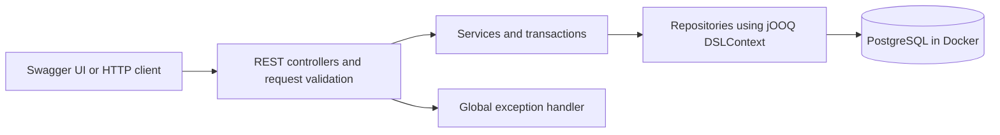

# M1 architecture

## Current runtime

The backend is a Java 21 Spring Boot application. It runs on the developer machine;
PostgreSQL 17 runs in Docker Compose with a persistent named volume, published only
on localhost at port 15432. Swagger UI is served by the backend and needs no frontend.

## Package responsibilities

| Package | Responsibility |
|---|---|
| `controller` | Versioned HTTP routes, request validation, response status and Location headers |
| `service` | Category lookup, listing rules, attribute validation, seller selection and transactions |
| `repository` | SQL through generated jOOQ tables, persistence and mapping to response DTOs |
| `dto` | Request/response records, listing type and field validation errors |
| `config` | OpenAPI metadata, reusable error schemas and documented responses |
| `exception` | Domain exceptions and consistent public error responses |
| `com.marketplace.jooq` | Generated tables and records under `target/`; never manually edited |

Constructor injection is used throughout. Controllers never execute SQL, and
repositories do not determine HTTP status. No JPA, Hibernate or redundant entity
model is used.

## Creation flow

1. Jackson parses a single unambiguous JSON document. Bean Validation checks the DTO.
2. ListingService validates fixed-price rules and currency, retrieves the category
   with its definitions and validates the supplied attributes.
3. The service checks the configured M1 seller and delegates the insert to the repository.
4. jOOQ binds values in SQL. PostgreSQL enforces foreign keys, price checks and defaults.
5. The response contains persisted values, including generated ID and timestamps.
   The controller returns 201 and a relative Location URL.

The service owns the transaction; insertion failures roll back. Read methods use
read-only transactions. Exceptions are handled centrally; see [API errors](api-errors.md).
The API offers creation and retrieval only. Update, delete and search are future work.

## Schema and build lifecycle

Flyway applies migrations automatically at startup. Shared V1/V2 migrations define
the schema and category data; local V3 supplies the test seller. Details and the
JSONB decision are in [database design](database-design.md).

During Maven `generate-sources`, Testcontainers creates a temporary PostgreSQL
instance. Flyway migrates it and jOOQ generates classes from the real schema.
Maven adds those sources to compilation. Integration tests migrate a second,
isolated PostgreSQL instance. Neither process uses the development database.

Docker is required for a clean compilation. This trades a build-time Docker
dependency for reproducible generation against the same SQL dialect as runtime.
The packaged application itself needs a reachable database, not a Docker daemon.

## Configuration and future deployment

`DB_URL`, `DB_USERNAME` and `DB_PASSWORD` override the local connection defaults.
`SERVER_PORT` changes the backend port. The default `local` profile loads the M1
seller seed and `marketplace.test-seller-id`. This is a development convenience,
not authentication. A missing seller produces a generic server error and an
internal log entry.

Planned later: React and Spring Boot on Cloud Run, PostgreSQL on Cloud SQL,
images in Cloud Storage, images for deployment in Artifact Registry and credentials
in Secret Manager. Cloud connectivity, production profiles and authentication must
be configured before deployment. They are not implemented in M1.

Auctions will introduce lifecycle and concurrent bid transactions in M3. Price
estimation will be researched separately in Python and later run inside the Java
backend, preferably through an ONNX-compatible model. No Python inference service
is planned. See the [research proposal](research-proposal.md).
