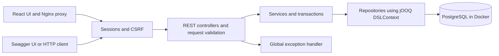

# M1 architecture

## Current runtime

The backend is a Java 21 Spring Boot application running in Docker Compose alongside
PostgreSQL 17. PostgreSQL persists to a named volume, published only on localhost:15432;
the backend is published on localhost:8081. Swagger is served by the backend.
An optional IDE/native workflow remains available.

The React authentication UI is served by a third Docker service at localhost:8082.
Its Nginx runtime proxies `/api/` to the backend and serves SPA routes. Registration,
login and account/logout use the same-origin session and automatic CSRF fetching.
See [frontend](frontend.md) for routes and test coverage.

## Package responsibilities

| Package | Responsibility |
|---|---|
| `controller` | Versioned HTTP routes, request validation, response status and Location headers |
| `service` | Category lookup, listing rules, attribute validation, seller selection and transactions |
| `repository` | SQL through generated jOOQ tables, persistence and mapping to response DTOs |
| `dto` | Request/response records, listing type and field validation errors |
| `config` | OpenAPI documentation, Spring Security and filter-level error responses |
| `exception` | Domain exceptions and consistent public error responses |
| `com.marketplace.jooq` | Generated tables and records under `target/`; never manually edited |

Constructor injection is used throughout. Controllers never execute SQL, and
repositories do not determine HTTP status. No JPA, Hibernate or redundant entity
model is used.

## Creation flow

1. Security checks authentication and CSRF for creation. Jackson parses a single
   unambiguous JSON document. Bean Validation checks the DTO.
2. ListingService validates fixed-price rules and currency, retrieves the category
   with its definitions and validates the supplied attributes.
3. The service resolves the authenticated seller and delegates the insert to the repository.
4. jOOQ binds values in SQL. PostgreSQL enforces foreign keys, price checks and defaults.
5. The response contains persisted values, including generated ID and timestamps.
   The controller returns 201 and a relative Location URL.

The service owns the transaction; insertion failures roll back. Read methods use
read-only transactions. Exceptions are handled centrally; see [API errors](api-errors.md).
The API offers creation and retrieval only. Update, delete and search are future work.

## Schema and build lifecycle

Flyway applies migrations automatically at startup. Shared V1/V2 migrations define
the schema and category data; local V3 supplies the legacy seller; V4 adds authentication. Details and the
JSONB decision are in [database design](database-design.md).

Native Maven builds use Testcontainers for generation. Docker image builds use
an isolated PostgreSQL process inside the build stage. In both cases, Flyway migrates
it and jOOQ generates classes from the real schema.
Maven adds those sources to compilation. Integration tests migrate a second,
isolated PostgreSQL instance. Neither process uses the development database.

The default workflow requires only Docker on the host. The build stage copies the
Maven/JDK toolchain into a PostgreSQL image; only its resulting JAR is copied into
a non-root JRE runtime. The separate verifier uses the Docker socket for tests.
The packaged application itself only needs a reachable database.

## Configuration and future deployment

`DB_URL`, `DB_USERNAME` and `DB_PASSWORD` override the local connection defaults.
`BACKEND_PORT`/`POSTGRES_PORT` change Compose host mappings. The internal server
port is 8080. The local profile retains the M1 seed for migration compatibility,
but new listings use authenticated accounts. See [authentication](authentication.md)
for cookies, sessions, CSRF and registration/login.

Planned later: React and Spring Boot on Cloud Run, PostgreSQL on Cloud SQL,
images in Cloud Storage, images for deployment in Artifact Registry and credentials
in Secret Manager. Cloud connectivity, production profiles, HTTPS settings and
shared session persistence remain deployment work.

Auctions will introduce lifecycle and concurrent bid transactions in M3. Price
estimation will be researched separately in Python and later run inside the Java
backend, preferably through an ONNX-compatible model. No Python inference service
is planned. See the [research proposal](research-proposal.md).
